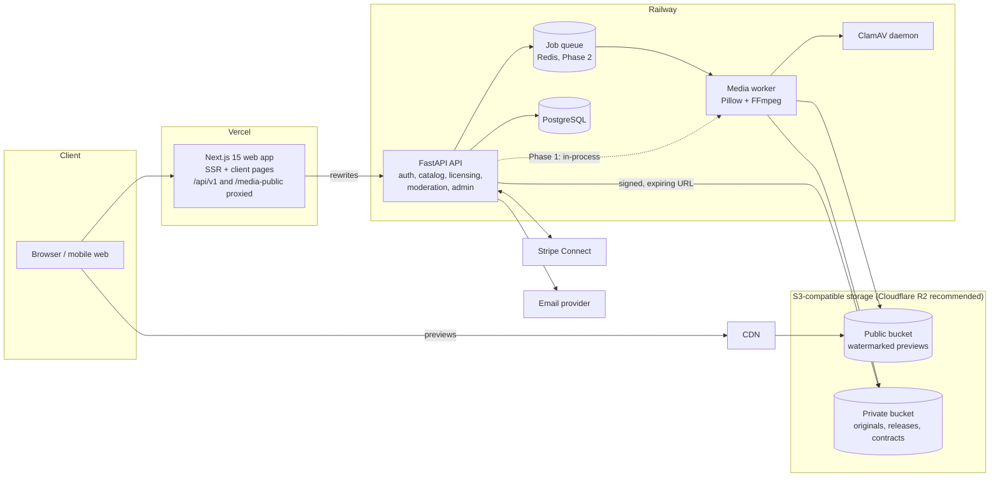

# System Architecture

Global photography, videography and digital-media marketplace, plus the Film
Production Exchange addendum. Independent brand operated by **One United
Enterprise LLC**; technology by **Azoth Digital** ("Powered by Azoth Digital").
The marketplace name and domain are still to be decided, so every brand value is
configuration (see [Branding](#branding)).

Related documents:

| Topic | Document |
|---|---|
| Database schema (built + planned) | [DATABASE.md](DATABASE.md) |
| Licensing, royalties, ledger, payments and payouts | [LICENSING_AND_ROYALTIES.md](LICENSING_AND_ROYALTIES.md) |
| Legal and regulatory dependencies | [LEGAL_AND_REGULATORY.md](LEGAL_AND_REGULATORY.md) |
| Infrastructure cost estimates | [INFRASTRUCTURE_COSTS.md](INFRASTRUCTURE_COSTS.md) |
| MVP, phases, schedule, what to postpone, addendum modules | [ROADMAP.md](ROADMAP.md) |
| Deploying to Vercel and Railway (PowerShell) | [DEPLOYMENT.md](DEPLOYMENT.md) |

---

## 1. High-level architecture



**Request path.** The browser only ever talks to the Next.js origin. Next.js
rewrites `/api/v1/*` (and `/media-public/*` in development) to the FastAPI
service, so the session cookie is first-party, `httpOnly`, `SameSite=Lax`, and
works without third-party cookies even though the API runs on Railway.

**Media path.** Uploads go to the API, which validates the file by magic bytes
(the browser-supplied type is ignored), scans it, extracts metadata, stores the
**original in a private bucket**, and writes **watermarked, EXIF-stripped
previews** to a public bucket behind a CDN. Originals are only reachable through
a short-lived HMAC-signed link issued after an entitlement check (and, on S3, a
5-minute presigned URL behind that).

**Money path (Phase 2).** Stripe Connect collects buyer payments. An append-only,
double-entry ledger in PostgreSQL records every financial event, and the royalty
engine allocates net revenue per the signed agreement's rule version. See
[LICENSING_AND_ROYALTIES.md](LICENSING_AND_ROYALTIES.md).

## 2. Core modules

Modules are Python packages inside one FastAPI service ("modular monolith"). A
module can be split into its own service later because each has its own models,
router and service layer and talks to the others through service functions, not
shared request state.

| # | Module | Responsibility | Status |
|---|---|---|---|
| 1 | **Identity & access** | Accounts, email verification, password reset, TOTP MFA, multi-role RBAC, organizations, sessions, rate limits | Built (orgs: schema only) |
| 2 | **Storefronts & discovery** | Creator/studio storefronts, follow, location- and specialty-based discovery, emerging talent | Built |
| 3 | **Media catalog** | Upload, validation, processing, renditions, metadata, releases, collections, favorites | Built |
| 4 | **Search** | Filters, facets, PostgreSQL full-text, natural-language filter extraction | Built (AI search: Phase 5) |
| 5 | **Licensing** | License catalog, versioned contributor agreements, creator pricing, rights grants, certificates, rights availability | Built |
| 6 | **Royalty engine** | Pure, tested revenue-split calculations (Models A/B/C, affiliates, collaborators) | Built; applied to every paid order line |
| 7 | **Payments & ledger** | Stripe Connect, orders, idempotent webhooks, double-entry ledger, payouts, refunds, disputes, referrals, reconciliation | Built (Phase 2) |
| 8 | **Trust & safety** | Moderation queue, automated advisory signals, appeals, DMCA notices and counter-notices, repeat-infringer tracking | Built |
| 9 | **Admin control center** | Users and roles, verification, moderation, complaints, versioned commission rules, legal review status, audit log, finance console | Built |
| 10 | **Production services** | Briefs, Request This Shot, matching, proposals, packages, bookings, milestones, deliverables, messaging, notifications, disputes, reviews, client galleries | Built (Phase 3) |
| 11 | **Partnerships** | Universities and clubs, collaborations, exclusive deals with e-signature, syndication | Phase 4 |
| 12 | **Subscriptions & enterprise** | Buyer and creator plans, credits, enterprise contracts, API keys | Phase 5 |
| 13 | **AI services** | Tagging, semantic search, matching, pricing hints, quality and moderation signals | Phase 5 (interfaces now) |
| 14 | **Production Exchange** (addendum) | Availability, Urgent Crew, vendors, bid exchange, packages, resources, contracts, expenses | After Phase 3, see [ROADMAP.md](ROADMAP.md) |

## 3. Key architectural decisions

1. **Modular monolith first.** One API service and one database keep cost and
   operational load at launch-stage levels. Module boundaries are explicit so a
   hot module (media processing first) can be extracted.
2. **Python/FastAPI + SQLAlchemy 2 + Alembic.** As specified. Migrations run on
   both PostgreSQL (production) and SQLite (fast tests).
3. **Money is integer cents; shares are basis points.** No floats anywhere in
   financial code. Rounding is defined (half-up for the creator pool,
   largest-remainder for collaborator splits) and always reconciles exactly.
4. **Versioned, immutable terms.** Agreement templates and revenue-share rules
   are never edited in place. A change creates a new version, and every signed
   agreement and issued license points to the exact version and a SHA-256 of
   the text the user saw. Administrators cannot retroactively alter signed
   financial terms through the API.
5. **Rights grants are the source of truth for usage rights.** Every free
   download or sale creates a `rights_grants` row and a certificate number. The
   rights-availability service checks grants before issuing new ones, which
   prevents conflicting exclusive licenses.
6. **Originals are private by construction.** Separate bucket, unguessable key,
   never mounted or CDN-exposed, delivered only via signed expiring links after
   an entitlement check; downloads are counted and audited.
7. **Authoritative numbers come from the server.** The frontend never computes
   balances, prices or permissions.
8. **Safety features default to off until the business is ready.** Paid
   licensing and exclusive licensing sit behind feature flags. In production,
   only counsel-approved agreement versions can be signed; exclusive deals can
   never be click-accepted. Production startup fails if the secret key, secure
   cookies or S3 storage are not configured.
9. **AI is advisory.** Duplicate and AI signals are shown to moderators as
   hints. They never auto-remove content and are never treated as proof.
10. **Cloudflare R2 for storage.** S3-compatible with no egress fees, which
    dominates cost for a video marketplace (see INFRASTRUCTURE_COSTS.md). Any
    S3 provider works by changing environment variables.

## 4. Security model

| Control | Implementation |
|---|---|
| Authentication | bcrypt (SHA-256 pre-hash) passwords; JWT in `httpOnly` cookie or Bearer header; token version bump revokes all sessions (logout-all, password reset, role or status change) |
| MFA | Optional TOTP; login returns a 5-minute "MFA pending" token that only the verify endpoint accepts |
| CSRF | Cookie-authenticated writes require `X-Requested-With: fetch` (cross-site forms cannot set it) plus `SameSite=Lax` |
| RBAC | Roles: buyer, creator, rights_owner, affiliate, org_admin, moderator, finance_admin, admin; dependency-level checks on every protected route |
| Rate limiting | Login, registration, reset, MFA, upload, downloads, complaints, certificate lookup (in-memory now; Redis when scaled out) |
| Uploads | Magic-byte type detection, size caps, decode verification, decompression-bomb guard, ClamAV hook, EXIF stripped from public renditions |
| Downloads | HMAC-signed, expiring tokens bound to an entitlement; per-entitlement download caps; audit entry for every original delivered |
| Headers | `nosniff`, `DENY` framing, strict referrer policy, permissions policy |
| Audit | Append-only `audit_logs` for auth, agreements, uploads, pricing, licenses, downloads, moderation, roles and commission rules |
| Secrets | Environment variables only; `.env` git-ignored; production guards on startup |

## 5. Project folder structure

```
Azothserviceandstockmarketplace/
├── README.md                    Quick start (PowerShell) and project overview
├── docs/                        Architecture, schema, royalties, legal, costs, roadmap, deployment
├── .github/workflows/ci.yml     Backend tests + lint, frontend typecheck + build
├── backend/                     Python · FastAPI · SQLAlchemy · Alembic
│   ├── app/
│   │   ├── main.py              App factory, middleware, router registration
│   │   ├── cli.py               seed / create-admin / demo commands
│   │   ├── core/                config (env + branding), database, security, deps (RBAC), rate limit
│   │   ├── models/              SQLAlchemy models (users, creators, media, licensing, moderation)
│   │   ├── schemas/             Pydantic request/response models
│   │   ├── api/v1/              Routers: auth, creators, agreements, media, search, licenses,
│   │   │                        library, trust, orders, earnings, production, messages, galleries,
│   │   │                        admin, admin_finance, public_config
│   │   └── services/            royalty_engine, rights_availability, media_processing, storage,
│   │                            scanner, search, licensing_service, media_service, email, audit,
│   │                            ledger, payment_service, payout_service, referral_service, payments/,
│   │                            production_service, messaging, notify, gallery_service
│   ├── alembic/versions/        Migration scripts
│   ├── tests/                   pytest suite (royalties, rights, auth, media flow, admin, video, migrations)
│   ├── Dockerfile, railway.json Railway deployment (FFmpeg included)
│   └── requirements*.txt, pyproject.toml, .env.example
└── frontend/                    Next.js 15 · TypeScript · Tailwind CSS 4
    ├── src/app/                 Routes: home, search, media/[id], creators, creators/[handle],
    │                            login/register/verify/reset, dashboard (+upload, media/[id]),
    │                            admin, licenses/verify, request-this-shot, legal/[slug]
    ├── src/components/          Header, Footer, MediaGrid, SearchBar, CreatorCard, Section, Alert
    ├── src/config/brand.ts      Brand configuration (env-driven)
    ├── src/lib/                 API client, session context, shared types
    └── next.config.ts, .env.example
```

Planned additions follow the same pattern: each new module adds
`models/<module>.py`, `schemas/<module>.py`, `api/v1/<module>.py` and
`services/<module>_service.py`, plus a migration and tests.

## 6. Branding

| Where | What |
|---|---|
| `backend/.env` | `BRAND_NAME`, `BRAND_TAGLINE`, `BRAND_DOMAIN`, `BRAND_LOGO_URL`, `BRAND_PRIMARY_COLOR`, `BRAND_SUPPORT_EMAIL` (emails, watermarks, TOTP issuer, API title) |
| `frontend/.env.local` / Vercel env | `NEXT_PUBLIC_BRAND_NAME`, `NEXT_PUBLIC_BRAND_TAGLINE`, `NEXT_PUBLIC_BRAND_LOGO_URL`, `NEXT_PUBLIC_SUPPORT_EMAIL`, `NEXT_PUBLIC_HERO_VIDEO_URL` |
| `frontend/src/app/globals.css` | `@theme` color tokens (`ink-*` charcoal scale, `gold-*` accent scale) and fonts |

"Lumen & Reel" is a placeholder working name. Clear any final name for trademark
availability before launch.

## 7. Integrating the Film Production Exchange addendum

The addendum extends the platform rather than adding a second site. It reuses:

| Shared system | Reused by |
|---|---|
| Users, roles, organizations | Production companies, vendors and crews are organizations; vendor is an `organization_type` |
| Creator profiles | Become *professional profiles* (categories already include director, sound engineer, cinematographer...) |
| Projects (built in Phase 3) | Urgent Crew, bid exchange, packages, contracts, expenses and dashboards hang off `projects` |
| Proposals and milestones (built) | Bid exchange submissions reuse confidential proposals and milestone payments |
| Messaging and notifications (built) | Urgent Crew alerts, RFP invitations, rebooking invitations |
| Ledger and Stripe Connect (Phase 2) | Package revenue allocation, booking commissions, vendor payments |
| Royalty engine `split_by_bps` | Team revenue allocation for production packages |
| Admin, audit, moderation | Employer verification, vendor listings, lead moderation |
| Search service | Availability and vendor search (same filter and facet pattern) |

New modular services: `availability`, `staffing` (Urgent Crew), `vendors`,
`bidding`, `packages`, `resources`, `contracts`, `production_finance`,
`leads`. Their tables are specified in [DATABASE.md](DATABASE.md), and their
order, complexity, cost and revenue estimates are in [ROADMAP.md](ROADMAP.md).
